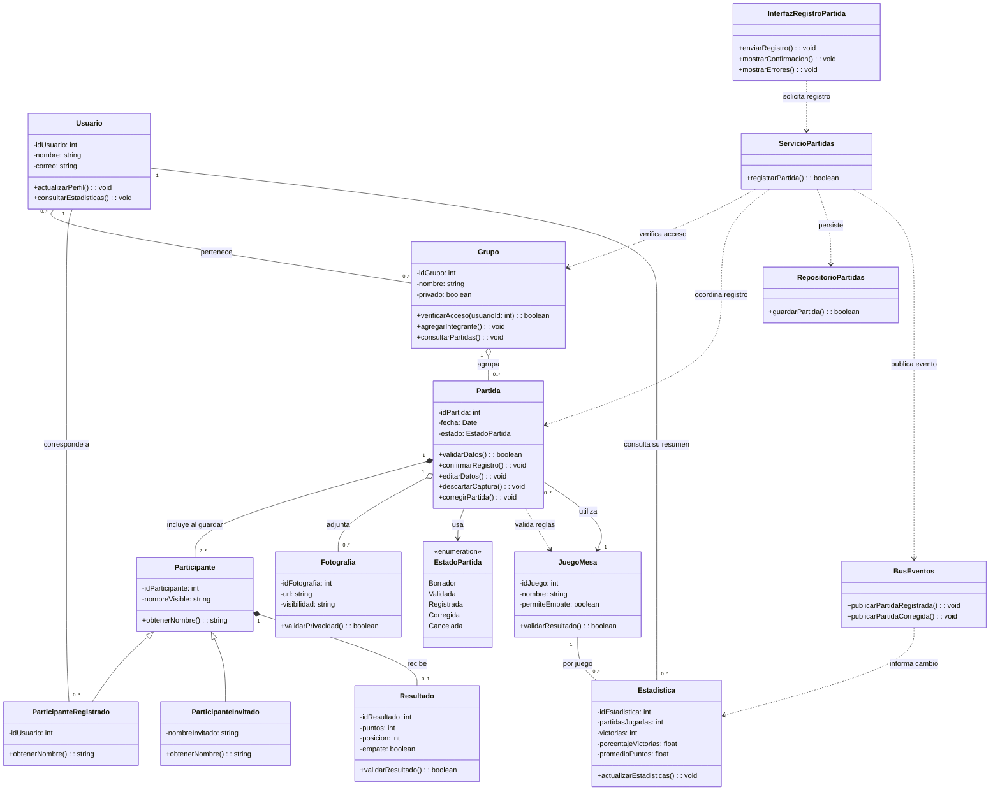
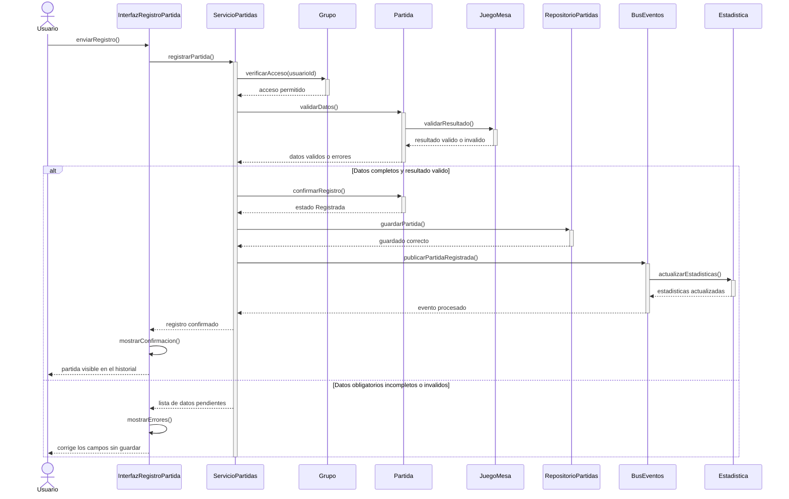
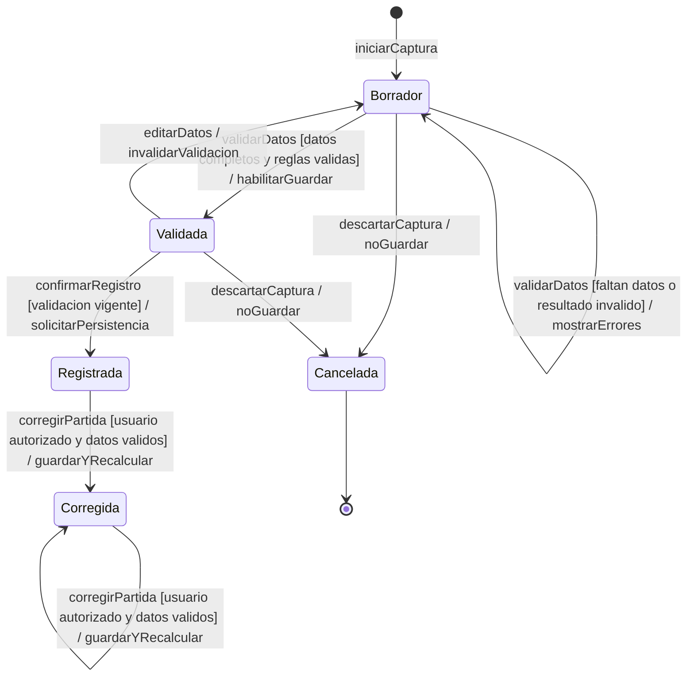
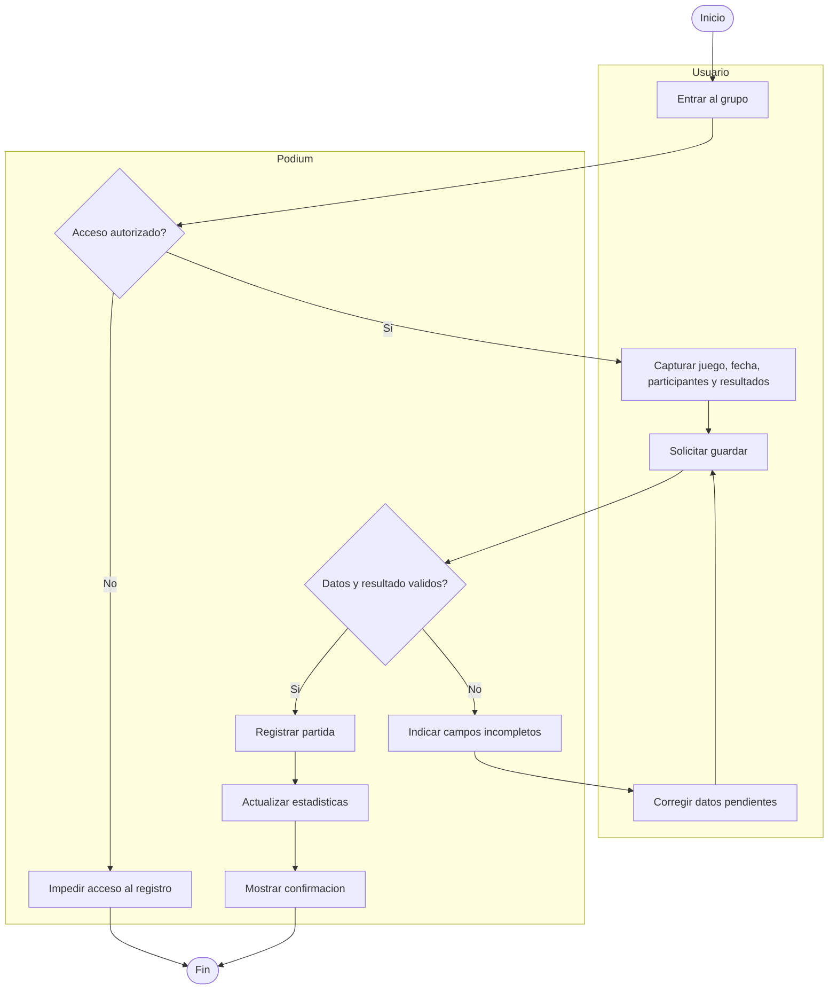

# Podium — Diagramas UML y consistencia (Unidad 4)

**Asignatura:** Ingeniería de Software I · SIS3407  
**Sistema:** Podium  
**Autor:** Josué Tiburcio Cruz  
**Actualización:** 16 de noviembre de 2026  
**Alcance:** diseño propuesto; los diagramas no demuestran una implementación terminada.

## 1. Propósito y fuentes de trazabilidad

Este documento consolida el **diagrama de clases**, el **diagrama de secuencia**, la **máquina de estados** y un **diagrama de actividad complementario**. El hilo conductor es **CU-01 — Registrar una partida**, descrito en `../../docs/especificacion-requisitos.md`. También se considera **CU-04 — Corregir una partida** al modelar el estado posterior al registro.

Los módulos y sus límites corresponden a los tres diagramas C4 de `diagramas.md` y al ADR de monolito modular: **Identidad y participantes**, **Grupos y contenido**, **Partidas** y **Estadísticas**. `RepositorioPartidas` y `BusEventos` son apoyos técnicos **internos** de la misma API; no representan microservicios adicionales.

**Decisiones de alcance:**

- La partida se guarda únicamente con juego, fecha, al menos dos participantes y resultados válidos (**RF-006**).
- Se admiten invitados sin cuenta (**RF-015**) y empates si el juego lo permite (**RF-017**).
- Una corrección autorizada actualiza las estadísticas (**RF-016**, **RF-007** y **RNF-CON-001**).
- **No se incorpora la anulación de partidas ya guardadas**, porque no hay un requisito funcional explícito que la autorice. `Cancelada` se usa únicamente para una **captura abandonada antes de guardarse**. La posible anulación posterior requiere una solicitud de cambio y una regla definida.
- La actualización de estadísticas debe completarse satisfactoriamente antes de confirmar la operación al usuario. El mecanismo concreto de recuperación ante fallos se decidirá en implementación, para cumplir **RNF-CON-001**.

## 2. Diagrama de clases — modelo revisado

El diseño conserva las entidades principales de Podium y agrega la coordinación necesaria para el registro. `Participante` es un **registro de participación en una partida**; no es la cuenta del usuario. Un mismo usuario puede tener distintos registros `ParticipanteRegistrado` en partidas diferentes.

**Criterios de modelado:**

- **Composición `Partida`–`Participante`:** se elimina el registro de participación si se descarta su partida; **no** se elimina la cuenta `Usuario`. La multiplicidad `2..*` describe una **partida registrada válida**, no un borrador aún incompleto.
- **Composición `Participante`–`Resultado`:** el resultado solo tiene sentido asociado al registro de participación. Se permite `0..1` mientras se captura; antes de registrar, **todos** deben tener un resultado válido.
- **Herencia:** `ParticipanteRegistrado` y `ParticipanteInvitado` especializan a `Participante`; un invitado no exige cuenta.
- **Servicio de aplicación:** `ServicioPartidas` coordina la operación. La entidad `Partida` conoce las reglas y su estado, pero no guarda directamente la base de datos ni envía eventos.
- **Clase y máquina de estados:** `Partida.estado` es de tipo `EstadoPartida`, con exactamente los cinco valores definidos en el diagrama siguiente.
- `InterfazRegistroPartida`, `RepositorioPartidas` y `BusEventos` son clases de frontera/soporte dentro de los contenedores existentes. Se muestran aquí para poder comprobar las operaciones utilizadas en la secuencia.

## 3. Diagrama de secuencia — CU-01 Registrar una partida

Escenario: el usuario tiene acceso a un grupo, introduce juego, fecha, participantes y resultados, y confirma. Se representa **un solo fragmento `alt`**: registro válido o datos incompletos/inválidos. Los casos de invitado y empate siguen documentados en CU-01 y se validan por las clases de dominio, sin agregar más ramas a este diagrama.

**Trazabilidad:** **CU-01**, **RF-006**, **RF-007**, **RF-015**, **RF-017**, **RNF-USA-001**, **RNF-CON-001**.

**Nota sobre persistencia y consistencia:** el diagrama es lógico y simplifica los detalles técnicos de transacciones. En el diseño de implementación se deberá garantizar que el registro y la actualización de estadísticas sean consistentes: si falla la persistencia o la actualización, **no** se debe anunciar éxito ni dejar estadísticas incorrectas. La ruta de fallo representada explícitamente mediante `alt` es la validación incompleta, como pide el ejercicio.

**Nota sobre acceso:** el permiso se comprueba porque CU-01 requiere que el usuario tenga acceso al grupo. La denegación de acceso es responsabilidad de seguridad, pero no se añade aquí como segundo `alt` para mantener el alcance del escenario solicitado.

## 4. Máquina de estados — ciclo de vida de Partida

La máquina representa el recorrido de **una sola `Partida`**. En esta versión no se inventa la facultad de anular partidas registradas: el estado `Cancelada` representa abandonar una captura antes de persistirla. La transición de corrección se refiere al requisito existente RF-016.

**Correspondencia exacta:** `EstadoPartida = {Borrador, Validada, Registrada, Corregida, Cancelada}`. Las etiquetas entre corchetes son **guardas** y el texto tras `/` es una **acción**.

**Aclaraciones de negocio:**

- Solo `Registrada` o `Corregida` representan resultados contabilizables. Un borrador invalidado o descartado no modifica las estadísticas.
- `Corregida` es el estado de una partida que fue registrada y posteriormente modificada; puede volver a corregirse.
- El cambio de estado a `Registrada` **solo se considera confirmado si la persistencia y las operaciones relacionadas culminan correctamente**. En caso de error técnico, el sistema no debe comunicar éxito.
- La anulación de partidas **ya registradas** queda fuera de esta máquina por no estar explícitamente contemplada en RF-016 ni en CU-01. No se presenta como capacidad existente de Podium.

**Trazabilidad:** RF-006, RF-016, RF-007 y RNF-CON-001; CU-01 y CU-04.

## 5. Diagrama de actividad — registro de partida (complementario)

El flujo se expresa por las acciones del **Usuario** y de **Podium**, e incluye la decisión sobre validez. Este diagrama de actividad es una **aproximación en Mermaid con `flowchart` y carriles `subgraph`**, según la guía del curso.

**Trazabilidad:** CU-01; RF-006 y RF-007. El usuario puede corregir un campo y volver a solicitar el guardado. La pantalla alternativa de datos incompletos se representa como comportamiento de diseño, no como prueba de código implementado.

## 6. Taller de consistencia — verificación cruzada

### Regla 1. Clases frente a secuencia

Cada **llamada de operación** del diagrama de secuencia aparece en una clase del diagrama revisado:

| Operación o mensaje enviado | Clase receptora | Resultado |
|---|---|---|
| `enviarRegistro()` | `InterfazRegistroPartida` | Existe |
| `registrarPartida()` | `ServicioPartidas` | Existe |
| `verificarAcceso(usuarioId)` | `Grupo` | Existe |
| `validarDatos()` | `Partida` | Existe |
| `validarResultado()` | `JuegoMesa` | Existe |
| `confirmarRegistro()` | `Partida` | Existe |
| `guardarPartida()` | `RepositorioPartidas` | Existe |
| `publicarPartidaRegistrada()` | `BusEventos` | Existe |
| `actualizarEstadisticas()` | `Estadistica` | Existe |
| `mostrarConfirmacion()` | `InterfazRegistroPartida` | Existe |
| `mostrarErrores()` | `InterfazRegistroPartida` | Existe |

Las **respuestas** punteadas (por ejemplo, "acceso permitido") son resultados de llamadas, no nuevas operaciones. Las operaciones de los servicios de aplicación se muestran en clases técnicas para hacer explícito quién las recibe.

### Regla 2. Clases frente a estados

La clase `Partida` declara `-estado: EstadoPartida`. Sus cinco valores son **Borrador, Validada, Registrada, Corregida y Cancelada**, los mismos que aparecen en la máquina. La creación de un borrador y los cambios de estado son **comportamientos propuestos**, no evidencia de funciones ya programadas.

### Regla 3. Trazabilidad a requisitos y casos de uso

| Artefacto | Requisito / caso de uso | Coherencia |
|---|---|---|
| Clases `Partida`, `JuegoMesa`, `Participante`, `Resultado` | CU-01; RF-006, RF-015, RF-017 | Forman el registro válido, invitados y empates. |
| Clases `Grupo`, `Usuario` | RF-003, RF-004, RF-012, RF-014 | Integrantes, grupos y permisos. |
| Clases `Estadistica`, `BusEventos` | RF-007, RF-016; RNF-CON-001 | Los cambios de resultados actualizan cálculos. |
| Secuencia CU-01 | CU-01; RF-006, RF-007, RF-015, RF-017 | Registro con caso exitoso y datos incompletos. |
| Estados de `Partida` | CU-01, CU-04; RF-006 y RF-016 | Captura, registro y corrección. |
| Actividad del registro | CU-01; RF-006, RF-007 | Flujo entre usuario y sistema. |
| `Fotografia` | RF-006 (foto opcional) y RF-014 (privacidad) | Se conserva como entidad del diseño original. |

**Limitación documentada:** el comportamiento de *anular una partida después de guardarla* no está solicitado explícitamente. Por lo tanto se **retiró** de la nueva máquina y del diagrama de clases para no crear una capacidad sin trazabilidad.

### Regla 4. Coherencia con C4 y ADR de Unidad 3

| Elemento técnico del diagrama | Módulo C4 / contenedor | Estado de coherencia |
|---|---|---|
| `Usuario`, `ParticipanteRegistrado`, `ParticipanteInvitado` | Identidad y participantes | Coherente |
| `Grupo`, `Fotografia` | Grupos y contenido | Coherente |
| `JuegoMesa`, `Partida`, `Resultado`, `ServicioPartidas`, `RepositorioPartidas` | Partidas | Coherente |
| `Estadistica` | Estadísticas | Coherente |
| `BusEventos` | Infraestructura de eventos **interna al backend** | Coherente; no crea un microservicio |
| `InterfazRegistroPartida` | Aplicación web (contenedor de interfaz) | Coherente |

El modelo mantiene un **monolito modular**, desplegado como una sola API/backend, y una aplicación web que lo consume. No presupone integración con WhatsApp ni con servicios de mensajería externos.

## 7. Hallazgos y correcciones de esta revisión

1. **Desajuste de activaciones:** en el diagrama de secuencia anterior algunas respuestas podían intentar desactivar al **receptor incorrecto**. Se reescribieron las barras para activar y desactivar la clase llamada, y dejar una sola alternativa de validación.
2. **Faltaba un coordinador:** la secuencia anterior pedía a `Partida` que guardara y publicara infraestructura directamente. Ahora `ServicioPartidas` coordina, `RepositorioPartidas` persiste y `BusEventos` comunica internamente.
3. **Faltaban operaciones:** la vista de clases se actualizó con las operaciones que realmente reciben mensajes en la secuencia, además de las operaciones para abandonar una captura y editarla.
4. **Estados no tipados:** se reemplazó el `string` original de `Partida.estado` por la enumeración `EstadoPartida`.
5. **Funcionalidad sin requisito:** se eliminó la anulación de partidas ya guardadas de la máquina de estados. Si la dupla pide ese cambio, será materia de una **SC** y su **AI** correspondientes.
6. **Consistencia de resultados:** se explicitó que no debe confirmarse éxito si el registro o la actualización estadística fracasan, sin afirmar que el mecanismo transaccional esté programado.

## 8. Estado del artefacto

**Estado del documento: revisión de diseño completada.** Las reglas de consistencia, la trazabilidad y la correspondencia entre mensajes, operaciones y estados fueron revisadas documentalmente contra `docs/especificacion-requisitos.md` y `doc/arch/diagramas.md`.

**Alcance de la validación:** esta documentación especifica un diseño **propuesto**. No acredita pruebas de software ni funcionalidad terminada. Al renderizar los bloques en GitHub o Mermaid Live se debe comprobar que su representación visual sea legible. Las correcciones aquí registradas deben mantenerse sincronizadas si más adelante se modifican otros artefactos.
