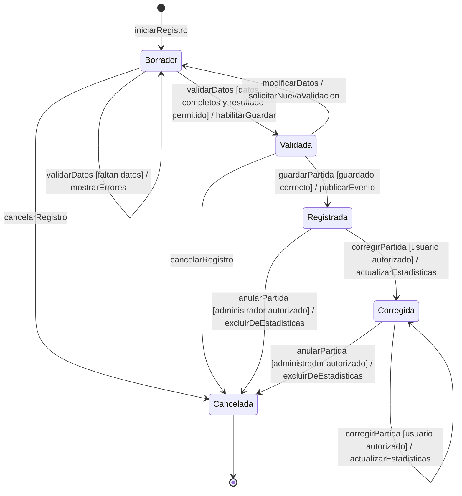
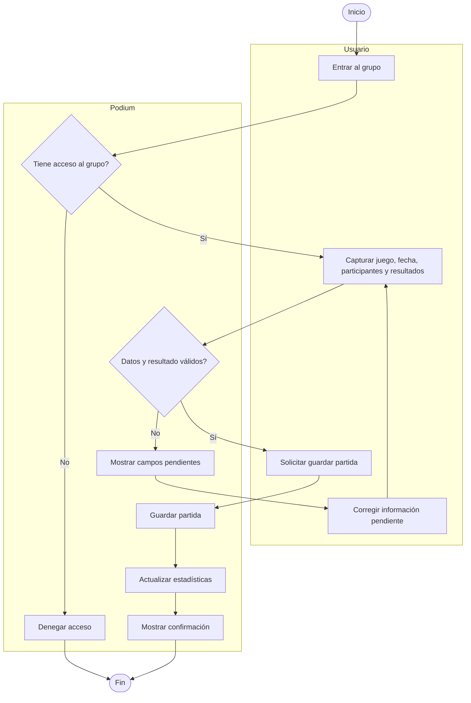
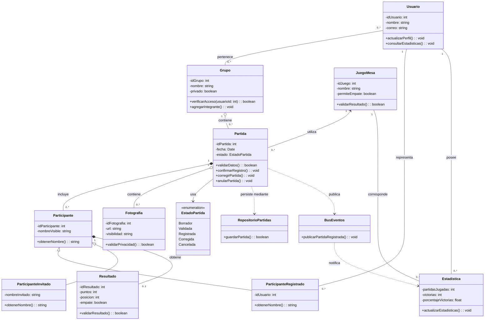

# Podium — Diagramas de comportamiento y consistencia (Unidad 4)

**Materia:** Ingeniería de Software I (SIS3407)  
**Sistema:** Podium  
**Responsable:** Josué Tiburcio Cruz  
**Estado:** Propuesta de documentación; los diagramas describen el comportamiento esperado, no una implementación terminada.

## Objetivo

Completar lo pendiente de la Unidad 4 para el caso de uso **CU-01 — Registrar una partida**, de manera que las clases, el escenario temporal, la máquina de estados y los requisitos de Podium sean coherentes. Se priorizó un solo escenario con un **`alt`** de validación, como solicita la guía de secuencia.

## 1. Diagrama de secuencia — CU-01 Registrar una partida

El usuario entra a un grupo, proporciona los datos de una partida y solicita guardarla. El grupo comprueba el permiso; la partida y el juego validan los datos. Si todo es válido, se guarda y se notifica a Estadísticas. Cuando falta información, el registro no se guarda.

```mermaid
sequenceDiagram
    actor Usuario
    participant Interfaz as Interfaz de registro
    participant Grupo
    participant Partida
    participant Juego as JuegoMesa
    participant Repo as RepositorioPartidas
    participant Eventos as BusEventos
    participant Stats as Estadistica

    Usuario->>Interfaz: Completa juego, fecha, participantes y resultados
    Interfaz->>+Grupo: verificarAcceso(usuarioId)
    Grupo-->>-Interfaz: Acceso permitido
    Interfaz->>+Partida: validarDatos()
    Partida->>+Juego: validarResultado()
    Juego-->>-Partida: Validez del resultado

    alt Datos completos y resultado permitido
        Partida->>Partida: confirmarRegistro()
        Partida->>+Repo: guardarPartida()
        Repo-->>-Partida: Registro guardado
        Partida-)Eventos: publicarPartidaRegistrada()
        Eventos-)Stats: actualizarEstadisticas()
        Partida-->>-Interfaz: Partida registrada
        Interfaz-->>Usuario: Muestra confirmación
    else Datos incompletos o resultado inválido
        Partida-->>-Interfaz: Datos pendientes y errores
        Interfaz-->>Usuario: Señala campos y no permite guardar
    end
```

**Trazabilidad:** CU-01; RF-006 (registrar), RF-007 (estadísticas), RF-015 (invitados), RF-017 (empates), RNF-CON-001 (consistencia) y RNF-USA-001 (usabilidad). El alterno coincide con la pantalla *Datos incompletos* del prototipo. No afirma que el registro o la notificación ya estén implementados.

**Nota de alcance:** este diagrama se centra en la validación y el registro, no en todos los alternos existentes de CU-01. El invitado y el empate se contemplan en los tipos de participantes y la validación del juego, pero pueden documentarse después en escenarios separados.

## 2. Diagrama de estados — ciclo de vida de Partida

En el diagrama de clases anterior, `Partida` tenía un atributo `estado: string`. Por consistencia, debe precisarse como `estado: EstadoPartida`, con **exactamente** los valores de la máquina siguiente. Los estados son situaciones (participios), y las transiciones indican evento, guarda y, cuando corresponde, acción.



**Trazabilidad:** RF-006, RF-016 (corregir) y RNF-CON-001. La transición de anulación es un **detalle de diseño propuesto** para representar la regla de que las partidas canceladas no se cuentan; si el requisito definitivo no permite anular una partida ya guardada, deberá ajustarse el diagrama y la especificación.

**Enum a incorporar en clases:** `EstadoPartida = { Borrador, Validada, Registrada, Corregida, Cancelada }`. No deben existir otros valores del atributo `Partida.estado` mientras se use esta máquina.

## 3. Diagrama de actividad — flujo de registro (complementario)

Este diagrama es útil porque el proceso cruza al usuario y al sistema y contiene una decisión visible. La guía lo presenta como útil **cuando el proceso lo justifica**, no como algo que haya que forzar en cualquier sistema. Mermaid aproxima las calles de actividad mediante `subgraph`.



**Trazabilidad:** CU-01, RF-006, RF-007 y flujo alterno por datos incompletos. La pantalla de éxito se representa como **comportamiento esperado**, aunque su existencia navegable debe verificarse por separado en Figma.

## 4. Ajustes necesarios al diagrama de clases

No basta con dibujar secuencia y estados: **cada mensaje entrante** debe tener una operación equivalente en la clase o componente que lo recibe. El diagrama original tenía parte de la lógica, pero faltaban operaciones y tipos más específicos.

| Elemento | Ajuste propuesto | Por qué |
|---|---|---|
| `Grupo` | Agregar `+verificarAcceso(usuarioId: int): boolean` | Recibe ese mensaje en la secuencia. |
| `Partida` | Mantener `+validarDatos(): boolean` y agregar `+confirmarRegistro(): void`, `+corregirPartida(): void`, `+anularPartida(): void` | La partida valida sus reglas y transiciones; la persistencia es responsabilidad de `RepositorioPartidas`. |
| `Partida.estado` | Reemplazar `string` por `EstadoPartida` | Debe coincidir exactamente con la máquina de estados. |
| `JuegoMesa` | Mantener `+validarResultado(): boolean` | Ya estaba previsto y se utiliza en la secuencia. |
| `Estadistica` | Mantener `+actualizarEstadisticas(): void` | Ya estaba previsto y recibe la actualización. |
| `RepositorioPartidas` | Incorporar `+guardarPartida(): boolean` como interfaz de persistencia | Se distingue almacenar datos de validar reglas. |
| `BusEventos` | Incorporar `+publicarPartidaRegistrada(): void` como infraestructura interna | Alinea la secuencia con los eventos internos del C4 nivel 3. |
| `Interfaz de registro` | Representarla como pieza de interfaz o controlador, según el nivel de detalle elegido | Recibe entradas del usuario y presenta resultados. |

> **Ajuste de responsabilidad:** `Partida` valida y cambia su estado; `RepositorioPartidas` guarda los datos. El diagrama se mantiene deliberadamente sencillo. En una implementación real, un servicio de aplicación podría coordinar estas responsabilidades sin convertir la entidad en propietaria de la persistencia.

### Vista de clases revisada (propuesta para el repositorio)

Esta vista parte del diagrama de clases que se trabajó en la actividad anterior y **agrega las operaciones descubiertas al dibujar el escenario**. Los elementos `RepositorioPartidas` y `BusEventos` son piezas técnicas internas; las demás son clases de dominio.



**Nota sobre participantes:** la multiplicidad `2..*` aplica al registro completo que puede guardarse. Un formulario temporal todavía incompleto puede tener menos participantes, pero no deberá pasar al estado `Registrada`.

---

## 5. Auditoría de consistencia entre diagramas

### Regla 1 — Clases frente a secuencia

- `Grupo.verificarAcceso` **faltaba** en la clase: agregar.
- `Partida.validarDatos` y `JuegoMesa.validarResultado` **ya estaban** representadas: conservar.
- `Estadistica.actualizarEstadisticas` **ya estaba** representada: conservar.
- `RepositorioPartidas.guardarPartida` y `BusEventos.publicarPartidaRegistrada` deben estar identificados como **interfaces/componentes técnicos** o incorporarse a la vista de clases correspondiente.
- **Responsabilidades:** `Partida` valida y cambia de estado; `RepositorioPartidas` persiste. La coordinación técnica se deberá detallar en implementación.

### Regla 2 — Clases frente a estados

- La clase `Partida` posee `estado`; sustituir su tipo `string` por `EstadoPartida`.
- Los valores son exactamente **Borrador, Validada, Registrada, Corregida y Cancelada**.
- Una partida que no llegue a *Registrada* no genera estadísticas; las correcciones de partidas registradas deben mantenerlas consistentes.

### Regla 3 — Todo frente a la Unidad 2

- **Secuencia**: CU-01, RF-006, RF-007, RF-015, RF-017.
- **Estados**: RF-006 y RF-016, con consistencia RNF-CON-001.
- **Actividad**: CU-01 y RF-006, RF-007.
- **Nuevo detalle funcional a confirmar**: posibilidad de anular una partida ya registrada; si no está respaldada por requisitos, eliminar sus transiciones o redactar una solicitud de cambio.

### Cruce con la Unidad 3 — Módulos C4

Se mantienen las fronteras del monolito modular: **Identidad y participantes**, **Grupos y contenido**, **Partidas** y **Estadísticas**. `BusEventos` funciona como infraestructura interna que conecta Partidas con Estadísticas y Grupos, no como un quinto microservicio. La API continúa desplegándose como una sola unidad.

## 6. Estado de este documento y uso en GitHub

**Este documento es un borrador de regularización de la Unidad 4.** Los cambios recomendados al diagrama de clases y a la especificación **no se consideran aplicados automáticamente** por escribirlos aquí.

Se propone guardar este archivo en `doc/arch/diagramas-unidad4.md`, junto a los diagramas C4 y el ADR ya existentes. Para completar el trabajo, comprobar los cuatro bloques en Mermaid y después actualizar el diagrama de clases y, si corresponde, los requisitos que se detectaron incompletos.
