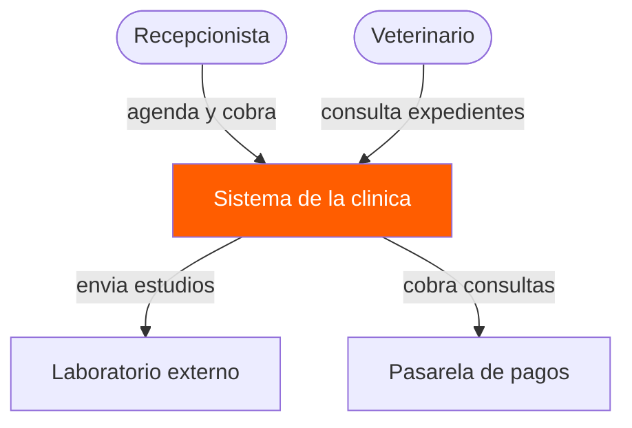
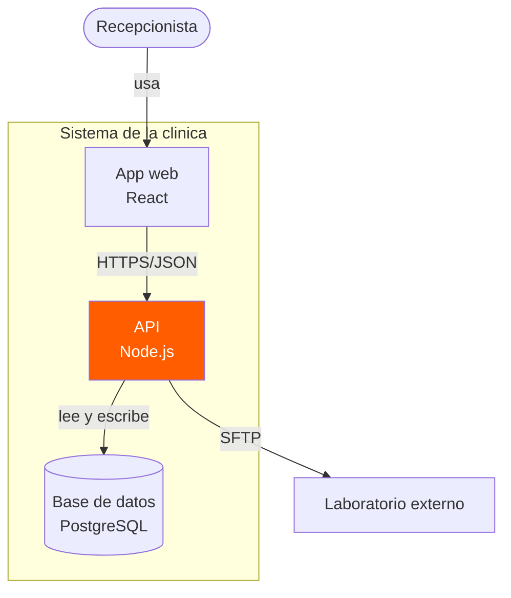
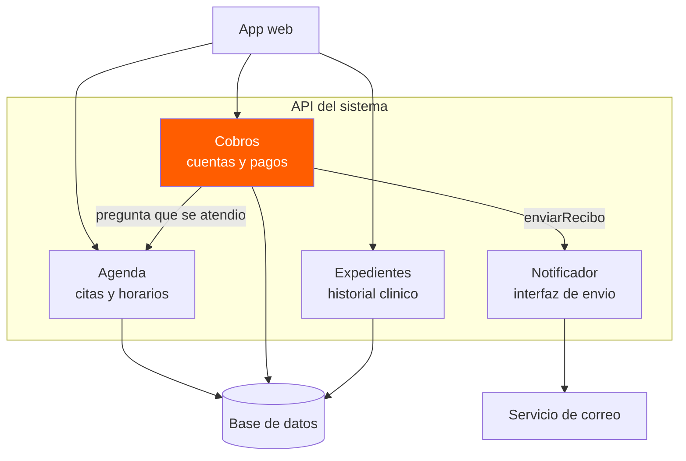
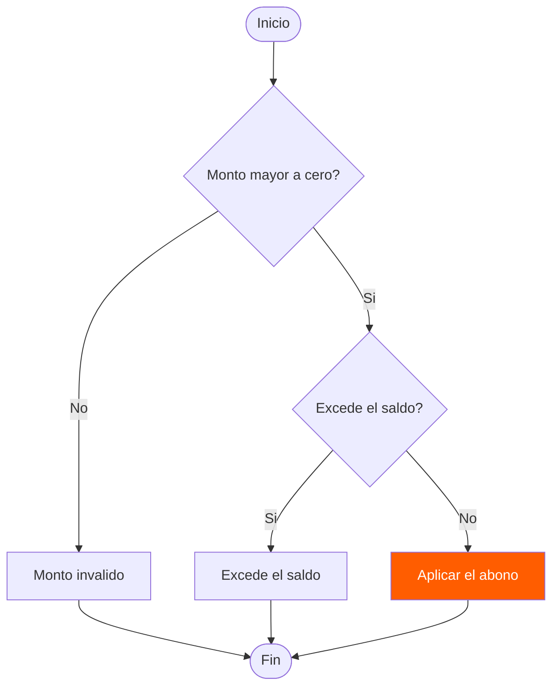
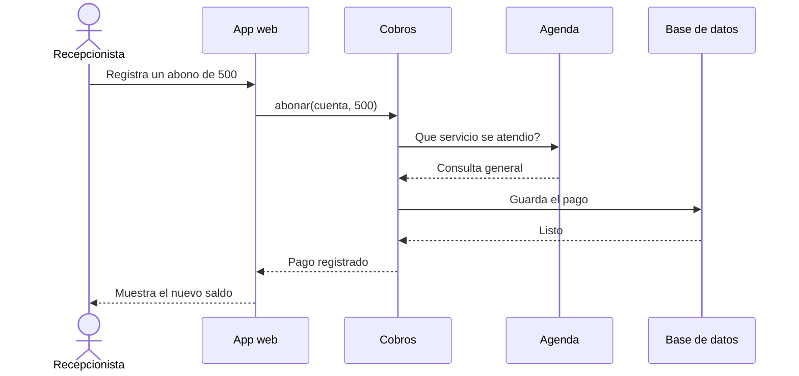
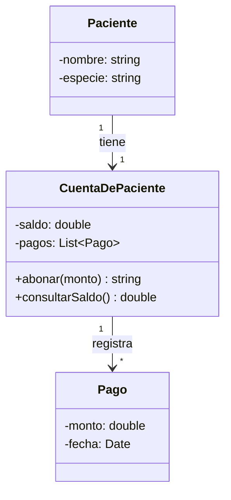
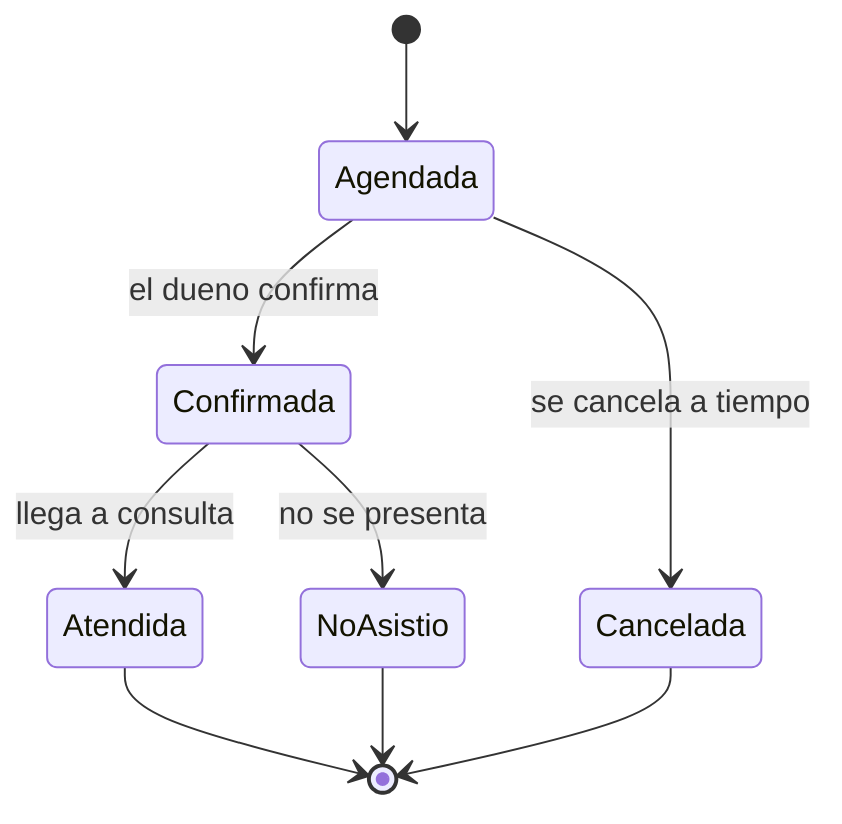
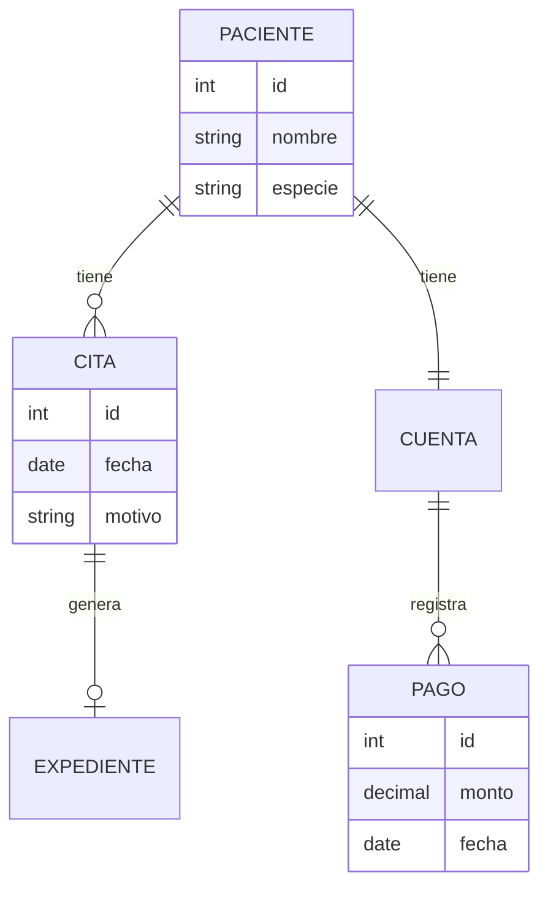

Este archivo reproduce los ocho ejemplos de diagramas de la guía de clase. Los primeros tres corresponden a los niveles 1, 2 y 3 del modelo C4; los cinco restantes son ejemplos para practicar.

## 1. Nivel 1 · Diagrama de contexto

El sistema completo, quién lo usa y con quién habla.

En este nivel no se especifican tecnologías: solamente el sistema, sus usuarios y las relaciones externas.

## 2. Nivel 2 · Diagrama de contenedores

Las piezas que se despliegan y se ejecutan por separado.

En este nivel sí se muestran tecnologías y el límite del sistema mediante `subgraph`.

## 3. Nivel 3 · Diagrama de componentes

Lo que hay dentro de un contenedor.

Este ejemplo representa la comunicación entre los componentes de la API del sistema.

## 4. Diagrama de flujo con decisiones

Los rombos y las flechas etiquetadas con Sí y No.

Representa las validaciones del monto de un abono.

## 5. Diagrama de secuencia

Cómo se pasan mensajes entre componentes, en orden temporal.

Muestra las llamadas y respuestas del registro de un abono.

## 6. Diagrama de clases

Atributos, métodos, visibilidad y multiplicidad.

El signo `-` indica un miembro privado, el `+` uno público y las multiplicidades indican cuántos elementos se relacionan.

## 7. Diagrama de estados

Por qué estados pasa una cita y qué evento produce cada cambio.

Los símbolos `[*]` indican inicio y fin del ciclo de vida.

## 8. Diagrama entidad-relación

Las tablas de la base de datos y sus relaciones.

Los símbolos de los extremos indican cardinalidad. Se mantiene el ejemplo y la estructura presentada en la guía.

---

**Nota:** Los ocho códigos anteriores corresponden al ejemplo académico de la clínica veterinaria mostrado en la guía. La adaptación al sistema Podium se realizará posteriormente.
