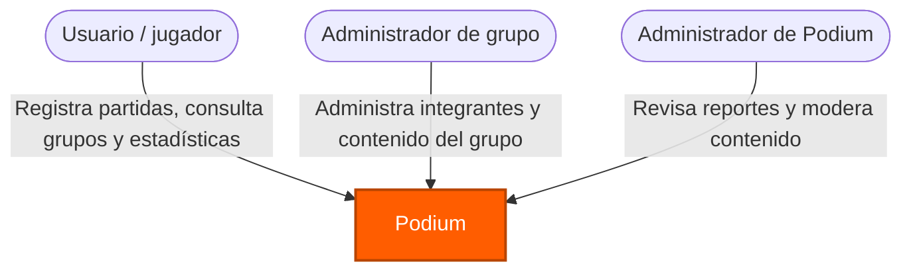
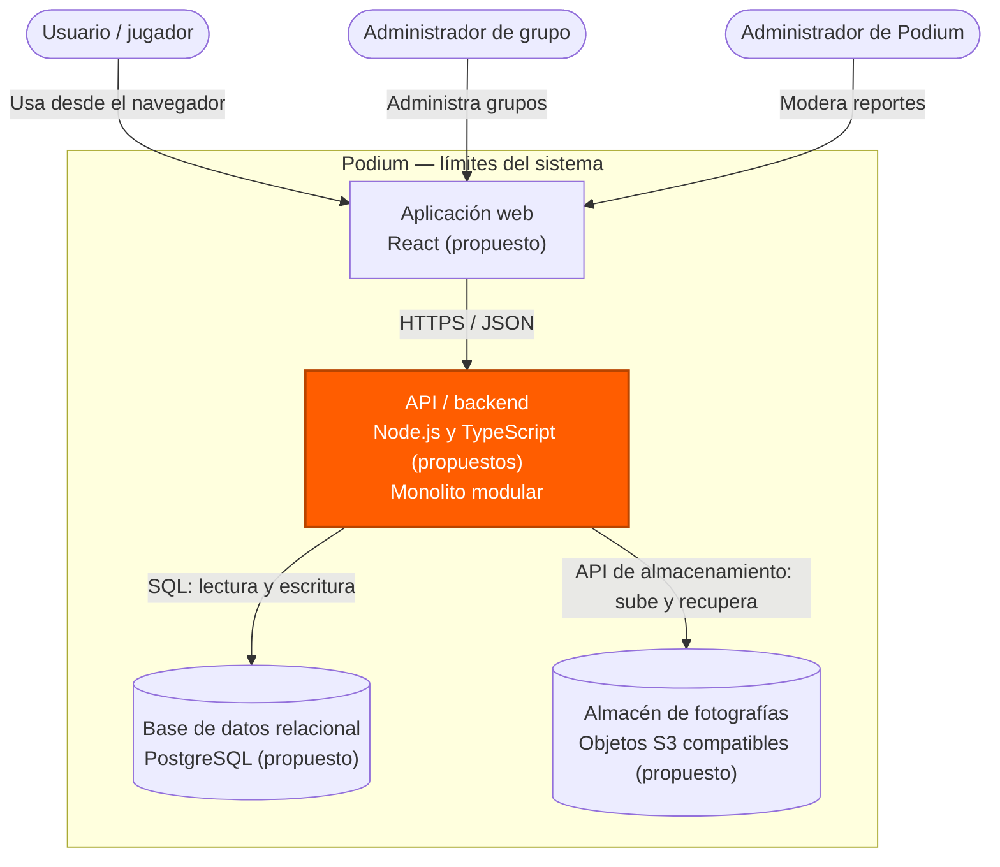
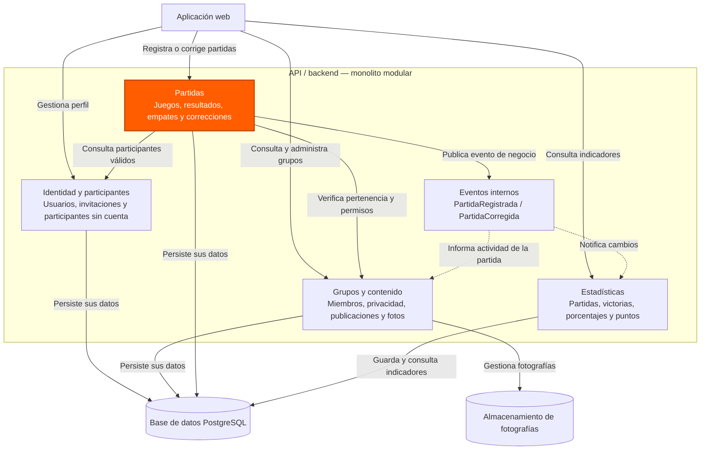

# Diagramas de arquitectura de Podium

**Materia:** Ingeniería de Software I (SIS3407)  
**Sistema:** Podium  
**Autor:** Josué Tiburcio Cruz  
**Fecha:** 29 de octubre de 2026  
**Decisión de arquitectura:** Monolito modular (ver [ADR-001](adr-001-monolito-modular.md))

## Propósito

Se representó la arquitectura propuesta de **Podium**, una aplicación web de tipo SaaS para registrar partidas de juegos de mesa, consultar resultados y estadísticas, compartir contenido y administrar grupos. Se utilizaron los tres niveles del modelo C4 solicitados en clase: **contexto, contenedores y componentes**.

Los diagramas describen un **diseño propuesto**, no un sistema ya implementado. Las tecnologías indicadas en el nivel de contenedores (React, Node.js/TypeScript, PostgreSQL y almacenamiento de objetos) son opciones para esta arquitectura y **todavía no representan herramientas instaladas ni integraciones construidas**.

## 1. Diagrama de contexto (C4 — nivel 1)

Este nivel muestra a Podium como un solo sistema y a las personas que lo utilizan. No se incluyen tecnologías ni servicios externos que no estén contemplados en los requisitos. WhatsApp es una herramienta que los jugadores usan actualmente, **no una integración de Podium**.

**Interpretación.** Se identificaron tres roles: quien participa en partidas y consulta resultados; quien administra un grupo; y quien modera contenido reportado a nivel general. Un participante invitado puede quedar registrado en una partida sin tener cuenta, por lo que no necesariamente interactúa de manera directa con la aplicación. La frontera es todo el sistema Podium.

## 2. Diagrama de contenedores (C4 — nivel 2)

Aquí se muestran las piezas ejecutables o de almacenamiento que se desplegarían por separado, sus **tecnologías propuestas** y los mecanismos de comunicación. La aplicación backend se despliega **como una sola unidad**; los cuatro módulos de negocio se muestran en el siguiente nivel, no como servicios independientes.

**Interpretación.** La interfaz web consume una API centralizada por HTTPS. Los grupos funcionan como inquilinos lógicos del servicio: la información se separa con identificadores de grupo y verificaciones de acceso, aunque se utilice una base compartida. La API concentra la lógica del negocio y persiste datos estructurados (usuarios, grupos, partidas, resultados y estadísticas) en PostgreSQL. Las fotografías se guardarían en un almacén de objetos, mientras que su información de acceso y asociación con grupos se conservaría en la base de datos. No se contemplan, por ahora, conexiones con WhatsApp, pagos ni servicios externos de correo.

## 3. Diagrama de componentes (C4 — nivel 3)

El contenedor que se detalla es **API / backend**. Dentro de él se mantienen los cuatro módulos definidos en la Actividad 2. Las relaciones se realizan mediante interfaces internas y eventos de dominio; no se plantean consultas directas a las tablas de otro módulo como mecanismo de integración.

**Interpretación.** **Identidad y participantes** gestiona cuentas e invitados; **Grupos y contenido** gestiona grupos, membresías, permisos y fotografías; **Partidas** valida y conserva los resultados; y **Estadísticas** produce los indicadores. Al registrar o corregir una partida, el módulo de Partidas publica un evento interno que permite actualizar estadísticas e historial sin conocer los detalles de implementación de los demás módulos. Este comportamiento es compatible con el patrón **Observer** identificado anteriormente.

### Coherencia entre los niveles

- **Contexto:** Podium es una única caja para las personas que lo usan.
- **Contenedores:** la API es **una unidad de despliegue** que se comunica con la web y los almacenes.
- **Componentes:** esa única API contiene **cuatro módulos de negocio**, más un mecanismo técnico de eventos internos; no son cuatro microservicios.

### Requisitos relacionados

- **RF-006 / RF-015 / RF-017:** registro de partidas, participantes invitados y empates → módulo **Partidas** con apoyo de **Identidad y participantes**.
- **RF-016 / RF-007:** corrección de resultados y estadísticas actualizadas → **Partidas**, eventos internos y **Estadísticas**.
- **RF-003 / RF-004 / RF-012 / RF-014:** grupos, pertenencia, información y privacidad → **Grupos y contenido**.
- **RF-018:** moderación de contenido reportado → **Grupos y contenido**, con permisos del administrador general.
- **RNF-PRI-001:** solo usuarios autorizados pueden consultar contenido privado → validación de permisos en **Grupos y contenido** y en cada operación relevante.
- **RNF-REN-001:** objetivo de respuesta de hasta **3 segundos** para pantallas principales en condiciones normales → criterio de rendimiento para la solución propuesta.

> **Nota de implementación:** La separación de módulos es lógica y se aplicaría mediante interfaces y control de acceso a los datos. Usar una base de datos compartida no autoriza a los módulos a saltarse las reglas de negocio de los demás. La selección tecnológica se presenta como propuesta, no como implementación confirmada.
